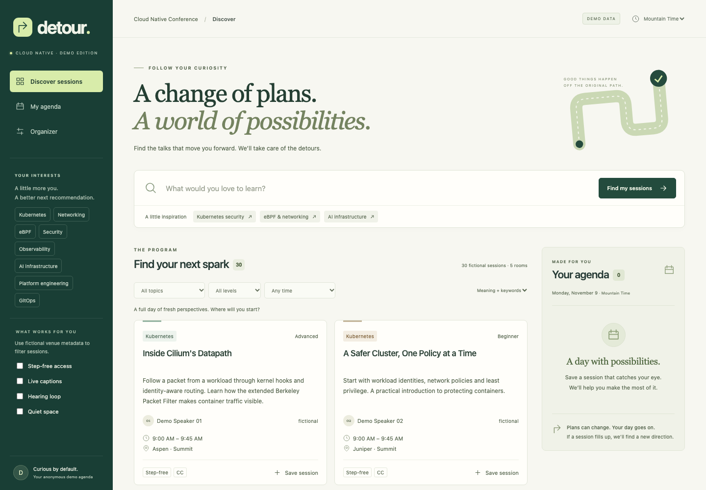

# Detour

**When conference plans change, Detour finds the next best experience.**

Search a fictional conference by meaning, save a personal agenda, then recover when
a room fills up or a session changes. An organizer view changes the same persisted
program that attendees search. Recommendations respect availability, accessibility,
time conflicts and the synthetic venue's transfer times.



[Mobile preview](docs/screenshots/mobile.png) · [Demo script](DEMO.md) · [Verified integration evidence](STORY.md)

All 30 sessions, speakers, venues, occupancy states and accessibility attributes are
**demonstration data**. They do not describe the actual hackathon venue. The public
organizer controls intentionally affect shared demo state; resetting clears all demo
agendas and disruptions. Do not use this deployment for a real event or personal data.

## Run locally

Requires Python 3.12, [uv](https://docs.astral.sh/uv/), and Node 22.12+.

```sh
uv sync --frozen --python 3.12
npm --prefix frontend ci --registry=https://registry.npmjs.org
npm --prefix frontend run build
```

Keep configuration in a private file **outside the repository**, with mode `600`.
Use `.env.example` for variable names; never put real credentials in a command,
commit, screenshot, PR, frontend variable, or container image.

```sh
uv run --env-file /secure/path/credentials.env uvicorn backend.main:app --host 127.0.0.1 --port 8080 --no-access-log
```

Open http://127.0.0.1:8080. For frontend hot reload, run
`npm --prefix frontend run dev`; Vite proxies API requests to port 8080.

An explicit credential-free preview is available:

```sh
DETOUR_STORE=memory uv run uvicorn backend.main:app --host 127.0.0.1 --port 8080 --no-access-log
```

Memory mode is labeled in the UI. It is temporary, keyword-only, and cannot establish
sponsor integration. The default mode is Elasticsearch; there is no silent fallback.

## Configuration

| Variable | Purpose |
| --- | --- |
| `DETOUR_STORE` | `elasticsearch` (default), or explicit `memory` preview |
| `ELASTICSEARCH_URL` | HTTPS endpoint of the Elasticsearch project |
| `ELASTICSEARCH_API_KEY` | Private key with read/write/index-management privileges for Detour demo indices and inference access |
| `ELASTICSEARCH_INFERENCE_ID` | Defaults to `.jina-embeddings-v5-text-small`; verified before indexing |
| `DETOUR_PUBLIC_ORIGIN` | Exact production HTTPS origin for proxy-aware same-origin writes and Secure cookies |
| `OTEL_SERVICE_NAME` | `detour-api` |
| `OTEL_EXPORTER_OTLP_ENDPOINT` | Dash0 **OTLP/HTTP** base URL from Settings → Endpoints |
| `OTEL_EXPORTER_OTLP_HEADERS` | `Authorization=Bearer%20<token>`; values must use the OTLP header format |
| `DASH0_AUTH_TOKEN` | Optional separate token for the developer MCP helper; needs query permissions |
| `DASH0_MCP_URL` | Optional organization-specific endpoint override from Dash0 Settings |
| `APP_VERSION` | Build SHA, supplied by the image workflow |

Elasticsearch indices are fixed to `detour-demo-sessions-v1`,
`detour-demo-agendas-v1` and `detour-demo-disruptions-v1`. Initialization creates
the mappings and seeds only when the demo state document does not exist. The
`semantic_text` field sends descriptions to the configured Jina model through EIS.
Keyword and semantic searches are combined with reciprocal rank fusion (k=60).
The UI allows keyword-only and meaning-only retrieval for a direct comparison.

## Scheduling decisions

- All stored timestamps are aware UTC. Display uses an explicit IANA time zone;
  the fictional program is November 9, 2026 in `America/Denver`.
- Sessions overlap when `start < other.end` and `end > other.start`.
- Transfer time is zero in the same room, 3 minutes within a building, and
  8 minutes between the fictional Summit and Canyon buildings. Step-free travel
  uses 12 minutes between buildings. These are synthetic assumptions.
- Required accessibility attributes must be explicitly `true` in verified demo
  metadata. Missing or unverified values fail the filter. Moving rooms revokes
  the old room's verification.
- Replacements cannot be canceled/full, already saved, rejected for that revision,
  earlier than the affected session, on another local conference day, or in conflict
  with another saved session (including transfer time).
- Rank by retrieval relevance, preferred-topic matches, start-time proximity,
  location transfer, start time, then stable ID. Explanations come from these rules.
- Replan one affected session at a time. Accepting revalidates current state; a
  stale alternative returns `409`. The next disruption is recalculated afterward.
- Anonymous agendas use random HttpOnly SameSite cookies, not real accounts or names.
  Agenda and organizer session writes use optimistic concurrency.

Session cards explain time/transfer conflicts with the saved agenda before saving;
the API revalidates them on every write. Topic interests prioritize replacement
recommendations; the program's topic, level, time and accessibility controls filter
search results. “Clear all filters” also clears selected accessibility needs, as
stated beside the button. Preference changes appear immediately and roll back if
the save fails. Background polling preserves failed-action feedback.

The deployment uses one Uvicorn worker and one replica to serialize demo writes.
This is a deliberate hackathon availability limit; add coordinated transactions
before scaling mutation traffic. Elasticsearch does not offer a transaction across
the session and disruption indices. Disruption events are recorded before a session
compare-and-swap, with best-effort cleanup on failure. A transport timeout can leave
the write outcome ambiguous; cleanup failure is logged without masking the original
error. This is not an atomic audit ledger. Agenda reads use real-time document GET;
session mutations await search refresh. Disruption history may appear one refresh
interval later (five seconds in the tested Elasticsearch project).

## API

| Method | Path | Behavior |
| --- | --- | --- |
| GET | `/api/meta` | Runtime store, inference ID, version and configuration status |
| GET | `/api/sessions` | Fictional program and persisted disruptions |
| GET | `/api/search` | `q`, `mode=hybrid\|keyword\|semantic`, topic, level, aware `after`/`before`, repeated accessibility filters |
| GET | `/api/agenda` | Cookie-scoped saved sessions, affected sessions, and `save_conflicts` keyed by session ID |
| POST | `/api/agenda` | `save`, `remove`, `preferences`, `accept`, or `reject` action |
| POST | `/api/demo/disruptions` | `room_full`, `cancel`, `update`, or `reopen` for a demo session |
| POST | `/api/replan` | Current disruption, up to three alternatives, or an explicit no-alternative result |
| POST | `/api/demo/reset` | Reset the fixed synthetic dataset and all demo agendas |
| GET | `/healthz` | Process liveness and build version |
| GET | `/readyz` | Datastore readiness; failed initialization is retried with backoff |

Writes require `Content-Type: application/json`, including an empty `{}` for replan
and reset. Browser writes require a matching origin. Configuration failures and
Elasticsearch failures return `503`; stale/conflicting changes return `409`.

## Tests and real integration checks

```sh
uv run pytest -q
npm --prefix frontend run build
npm --prefix frontend run test:e2e
uv run --env-file /secure/path/credentials.env python -m scripts.verify_elastic
```

Start the app before browser tests. `DETOUR_BASE_URL` changes their target. Browser
tests **reset the shared synthetic dataset**; run them against a dedicated demo
instance while no one is presenting. CI runs backend tests, frontend compilation,
and Chromium workflows using explicit memory mode, with no sponsor credentials.
Live Elasticsearch verification separately checks Jina retrieval and persistence.

The browser scenario saves a session, changes availability from another page,
waits for attendee polling, accepts a replacement and checks the persisted agenda.
It also checks a narrow viewport, keyboard search, UTC display, the in-flight polling
race, and automated WCAG AA rules on attendee and organizer views. Automated checks
do not establish complete accessibility conformance.

## Container and Radar GitOps deployment

```sh
docker build -t detour:local .
docker run --rm -p 8080:8080 --env-file /secure/path/credentials.env detour:local
```

The multi-stage image serves the frontend and API from one non-root process on
port 8080. It contains neither build credentials nor a second database. The Kubernetes
Service remains `app`, port 80, in `team-bumblebee`; the allocated public hostname is
https://bumblebee.cnh.radarhq.io. See [STORY.md](STORY.md) for verified rollout status.

Create a Secret named `detour-credentials` in `team-bumblebee` through Radar's Secret
editor or a secure local terminal. Required keys are `ELASTICSEARCH_URL` and
`ELASTICSEARCH_API_KEY`; Dash0 uses `OTEL_EXPORTER_OTLP_ENDPOINT` and
`OTEL_EXPORTER_OTLP_HEADERS`. Never check in a filled Secret manifest.

Feature changes land through reviewed PRs. On merge to `main`, GitHub Actions builds
and publishes `ghcr.io/srbhklkrn/cloudnative-hackathon:<commit7>`, then writes a
`deploy: <commit7> [skip ci]` commit updating Kustomize. Read that build's result and
pull its deployment commit before the next push. The GHCR package must be public.

Apply `argocd/application.yaml` **once** through Radar MCP, targeting cluster
`bumblebee` (`7rQNMDbB570`). Thereafter sync Application `app` in `team-bumblebee`,
check its synced revision, check the live Deployment's image, wait for readiness,
then request the public `/healthz`, `/readyz` and an actual search. Never treat a
healthy old replica or a green build as proof that the new version is deployed.

Do not directly patch Argo CD-owned resources or modify the preinstalled platform.
The pod requests 100m CPU/256Mi and limits 500m CPU/512Mi, within the team quota.

## Observability and sponsor evidence

OpenTelemetry exports directly over OTLP/HTTP without a cluster-wide operator.
Custom spans cover `detour.search_sessions`, `detour.semantic_search`,
`detour.detect_disruption`, `detour.rank_recommendations` and `detour.replan_agenda`.
Request, search and replan latency, replan outcomes, disruption counts, datastore
errors and alternative counts are metrics. Logs include trace IDs and bounded
route/status fields. Cookies, authorization headers, request bodies and query text
are excluded. Configuration status in `/api/meta` is not proof of successful ingestion.

The developer MCP helper uses the official MCP Python client and local credentials:

```sh
uv run --with mcp --env-file /secure/path/credentials.env python -m scripts.dash0_mcp list
```

Discover the advertised tool schema before using `call TOOL '{...}'`. Query access
requires an appropriate token; an ingestion-only token is insufficient. Agent0
investigations and dashboards must be verified against live telemetry.

The 12-panel [dashboard definition](observability/dash0-dashboard.json) was created
through the [official Dash0 REST API](https://www.dash0.com/docs/api-reference/operations/post/api/dashboards)
and read back through both API and MCP. It uses Detour's custom request histogram,
avoiding duplicate framework metrics. Find `detour-disruption-recovery` in your
[Dash0 dashboards](https://app.dash0.com/dashboards?org=04f0aadf-6701-43ec-92a9-61f3ef36109d).
Zero datastore failures are displayed as zero; empty latency panels indicate missing
traffic, not zero latency. Agent0 API-token conversations may not be visible to your
user account; the verified findings and trace links are preserved in STORY.md.

[STORY.md](STORY.md) records actual Gitar reviews, fixes, CI diagnosis, live Elasticsearch
checks, Radar operations and Dash0 evidence. It explicitly tracks unverified work.
[DEMO.md](DEMO.md) is the presentation script.

The [interactive architecture diagram](docs/architecture.html) is a standalone HTML
artifact generated with Archify, linked to repository source. Its [validation
receipt](docs/architecture-validation.json) records passing schema, artifact,
provenance and real-browser gates. Diagram visual review was not requested.

## AI assistance and participant contribution

OpenAI Codex assisted with implementation, tests, documentation and tool operation;
Gitar reviewed changes and generated fixes. The participant selected Detour's product
scope, supplied the architecture and scheduling requirements, chose the sponsor
workflow, and configured the sponsor accounts and credentials. The participant must
review and understand the submitted implementation and explain the decisions above.
Automated checks support that review; they do not replace it.

Deployment instructions and agent workflows originate from the
[Radar Cloud Native Hackathon starter](https://github.com/skyhook-io/cnh-starter).
